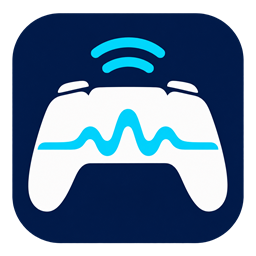

<p align="center">
  
</p>
<h1 align="center">DualSense AirBridge</h1>
<p align="center">Bring DualSense haptics across the wireless gap.</p>
<p align="center"><a href="README.md">简体中文</a> · <strong>English</strong></p>
<p align="center">Windows x64 · Standard DualSense · Release 0.1.5 · MIT</p>

DualSense AirBridge is an unofficial Bluetooth bridge for **Windows PCs and the standard DualSense controller**. Pair the controller through Windows as usual. The tool presents a virtual USB DualSense to compatible games, exposing native input, detailed haptics and adaptive-trigger output paths.

It is intended for PC games with native DualSense support. **It is not a universal PS / Xbox controller mapper, and cannot add effects that a game does not implement.** Phantom Blade Zero (《影之刃：零》) is the first priority for game validation.

> **Support limits:** Testing and user feedback come from a limited hardware setup, not broad compatibility certification. The controller speaker is muted by default and can be enabled in the app; microphone and 3.5mm audio have not been validated. The project does not claim complete wireless support for every USB feature or zero latency.

## Features and scope

| Item | Current status |
| --- | --- |
| Standard DualSense, VID `054C` / PID `0CE6` | The only model currently allowed for bridging |
| Buttons, sticks, trigger input and touchpad | Input forwarding and manual comparisons performed |
| Detailed left/right haptics | Confirmed in standalone tests and subjective game use; not just conventional rumble emulation |
| Adaptive triggers | Game output forwarding; built-in R2 resistance and cancellation/reset tests passed |
| Native USB / Bluetooth restoration | Normal stop removes session changes and checks physical input and the previous audio endpoint |
| Separate Bluetooth audio | Multiple observation windows passed with a Bose device; other adapters and interference conditions remain unverified |
| Controller speaker / microphone / 3.5mm audio | Speaker muted by default with a manual option; microphone and 3.5mm audio remain unvalidated |
| DualSense Edge / DualShock 4 / Xbox controllers | Not supported as bridge targets; coexistence with other controllers still needs hardware testing |
| Linux / macOS / Windows ARM64 | Not supported by this application |

Built-in feedback and latency-comparison panels send identical test signals through physical USB and Bluetooth bridging. Software timings describe queues and report arrivals; **they do not measure physical end-to-end latency**.

## v0.1.5: interface, controller controls and recovery

The [v0.1.5 official release](https://github.com/stayupchampion/DualSense-AirBridge/releases/tag/v0.1.5) promotes the hardware-accepted `0.1.5-dev.4` functionality. The refreshed interface uses light grouped panels and sidebar navigation, with separate connection, recovery and guide pages and consistent feedback/latency windows.

- Battery and charging state refresh about every 5 seconds. Bridge mode reuses received input reports without extra controller queries. Capacity is quantized in roughly 10% bands and shown as approximate. Native mode reads one shared input report without changing reporting modes; simple Bluetooth reports may omit battery data. Missing or stale data is not shown as 0%.
- **Controller speaker mute defaults to on.** Unchecking the option returns speaker control to the game. The preference applies only to this bridge session and resets to muted when the app opens. Haptics, adaptive triggers, microphone and headset fields are preserved; the four-channel virtual USB endpoint is never muted as a whole.
- A read-only Windows playback-device, volume and mute display refreshes about once per second. This does not prove physical loudness.
- Virtual speaker/microphone USB volume state is separated. System-audio queries and default-device protection run in a child process with time limits, allowing shutdown to proceed independently of audio queries.
- Command timeouts, USB/IP handshakes, disconnect status and shutdown recovery are hardened. Shutdown releases bridge lighting, requests firmware-native Bluetooth lighting and reports handoff failures separately. Previously validated haptic buffering is retained.

**Normal stop and direct window close passed hardware acceptance:** the user confirmed working haptics and triggers, restored steady blue lighting, uninterrupted Bose playback and effective volume keys. Natural standby/reconnection and native USB fallback still need retesting on this version. A driver policy excluding virtual endpoints from default-device selection is not enabled; this acceptance does not establish that every Bluetooth audio fault is resolved.

Recovery reverts only tool-owned changes and preserves subsequent user adjustments to external volume and other software settings. No startup item, system service or new driver is added. Exact restoration of unreadable firmware state or arbitrary prior custom lighting is not promised. See [release notes](docs/releases/v0.1.5.md), [controller controls](docs/controller-controls.md), [audio protection](docs/audio-safety-candidate.md), [stability/recovery review](docs/stability-recovery-review.md) and [controller-state recovery](docs/controller-state-recovery.md). Detailed engineering records are in Chinese.

## How it works

```text
PC game with native DualSense support
             ↕ USB input / output / audio
Virtual USB DualSense (usbip-win2)
             ↕ Local USB/IP
Session-managed, modified vDS backend
             ↕ Windows Bluetooth HID
Standard DualSense controller
```

During bridging, HidHide hides the selected physical controller from other applications to reduce duplicate input from physical and virtual devices. The tool journals its changes and reverts them when the session stops. The vDS backend starts and exits with the session; the upstream vDS background service is not installed.

## Setup and use

Hardware validation was performed on **Windows 11 x64**. A Bluetooth adapter that connects the controller normally is required. Other Windows versions, adapters and firmware combinations have not been comprehensively tested.

| Component | Purpose | Tested version |
| --- | --- | --- |
| [usbip-win2](https://github.com/vadimgrn/usbip-win2/releases/tag/v.0.9.8.1) | Virtual USB controller and local device import | 0.9.8.1 x64 |
| [HidHide](https://github.com/nefarius/HidHide/releases/tag/v1.5.230.0) | Isolate the physical HID to avoid duplicate input | 1.5.230.0 x64 |
| .NET 9 runtime | Windows desktop application | Included by the self-contained build; no separate SDK needed |
| Modified vDS and Opus | Bluetooth bridge and audio encoding | Included by the build; Opus is statically linked |

usbip-win2 and HidHide are **system-level dependencies**. Install their official releases and reboot when requested. The app does not automatically install drivers or modify firmware. Installed drivers may load with Windows: no app autostart does not mean no loaded drivers. Third-party installer services, tasks and updaters follow those installers' settings.

1. Download and extract the Windows x64 package from [Releases](https://github.com/stayupchampion/DualSense-AirBridge/releases), or build from source below. Keep the whole package together, not just the EXE.
2. Install the dependencies above. Check existing shared installations before replacing versions or changing another controller application's setup.
3. Exit the game, unplug the controller's USB cable, and pair/connect the DualSense through Windows Bluetooth. Close software that may take over the controller.
4. Run `DualSenseBridge.exe`. The executable retains its earlier name; the project is now called **DualSense AirBridge**. The application UI is currently in Simplified Chinese.
5. Click **检查连接** (Check connection), select the Bluetooth DualSense, then **启用蓝牙桥接** (Enable Bluetooth bridge). The session manager requests administrator permission.
6. Wait until connected before launching the game. The game must support native DualSense. If necessary, select **Disable Steam Input** in that game's Steam Properties → Controller override so it reads the virtual DualSense directly. A global controller-support change is unnecessary.
7. Exit the game first, then click **停止并恢复原生** (Stop and restore native connection), or close the tool normally. After restoration completes, use native Bluetooth or reconnect USB.

Avoid switching modes while a game is running. Virtual USB and physical Bluetooth are different devices; a game may need a restart to recognize the replacement.

## Everyday behavior, recovery and removal

- **No app autostart by default.** No automatic bridging service or scheduled task is created. Opening the window does not enable bridging.
- Only the selected standard DualSense receives hiding rules. Conflicting existing rules, other mapping software, an occupied local port `3240`, or unfinished recovery records block startup.
- The app attempts to preserve the previous default audio output. It does not route main game audio to the controller or enable a separate headset's microphone. Bluetooth radio capacity remains shared; uninterrupted audio cannot be guaranteed for every setup.
- Normal exit stops output, releases trigger forces and haptics, removes the session's virtual device and restores its hiding changes. Concurrent external configuration changes are reported rather than overwritten blindly.
- If the UI exits unexpectedly, a separate session process attempts recovery. **Power loss, a system crash or forcibly killing all related processes can leave persistent hiding rules.** On the next launch, use **恢复遗留状态** (Recover leftover state). Keep the application's `.local/` directory until recovery completes.
- Deleting the app does not uninstall the drivers. After recovery, use Windows Installed apps if removal is needed. Keep dependencies that other software also uses.

## Latency work and validation

Version 0.1.3 removed HID input waits that blocked audio in the USB/IP receive thread, adjusted local TCP sending and set priming to **3 chunks, approximately 32ms of PCM data**. Version 0.1.4 keeps that setting, moves ordinary diagnostics to a bounded background queue, and formats statistics outside shared state locks to reduce occasional waits caused by logging.

The v0.1.5 functional candidate passed **238 C# checks**, C++ runtime/audio/handshake/diagnostic checks and **4 patch-compatibility checks**. Normal stop and direct window close passed hardware acceptance; **19 recovery observations over about 95 seconds** reported no warnings, with normal Bose playback and effective volume adjustment. Earlier user feedback described the optimized vibration feel as close to USB; this version retains that buffering and makes no new latency-reduction claim. These results describe one setup and observation windows, not equal physical latency or permanent stability across games and radio conditions.

See the [0.1.3 haptics work](docs/haptics-latency-optimization.md), [0.1.4 diagnostics work](docs/diagnostic-jitter-optimization.md), [validation record](docs/validation.md), [feedback tests](docs/feedback-tests.md) and [latency-comparison procedure](docs/latency-comparison.md). These detailed records are currently in Chinese. Historical status statements apply to their dates and versions; raw `.local/` receipts mentioned there are not included in the source repository.

## Build from source

Development dependencies: .NET 9 SDK, Visual Studio 2022 C++ tools and Windows SDK, Python 3, and CMake. End users do not need these development tools.

```powershell
# Run from the repository root
powershell -NoProfile -ExecutionPolicy Bypass -File scripts/build.ps1
powershell -NoProfile -ExecutionPolicy Bypass -File scripts/test-backend.ps1
```

Output: `dist/DualSenseBridge/`. The build downloads and verifies pinned vDS and Opus sources, stores caches under the project's `.local/`, and does not install system drivers. The default CMake path is the VS 2022 Community bundled location. For another installation, run `scripts/build-backend.ps1` with `-CMake` and `-Python`, then `scripts/build.ps1 -SkipBackend`.

`scripts/check-installed-drivers.ps1` only reads system state and saves reports under `.local/logs/`. The maintainer installation script requires the pinned installers, administrator privileges and an explicit `-InstallApproved` flag; use the official installer workflow above for initial setup. `scripts/test-hardware-session.ps1` actively starts and stops bridging: read it first, close games, use administrator privileges and connect exactly one standard Bluetooth DualSense.

Tagged releases are rebuilt from source by GitHub Actions with software checks, a ZIP archive, SHA-256 checksums and a build manifest. CI does not install drivers or exercise physical controllers; hardware findings come from the development setup described above.

## Credits, references and dependencies

**The bridge protocol implementation and backend are based on [hurryman2212/vds](https://github.com/hurryman2212/vds), not reverse-engineered from scratch by this project.** The pinned commit is `ec531599dfdd02e14ce68efd8c0d2dcb439894a5`. This project adds Windows session/recovery management, test panels, input/audio scheduling fixes and diagnostic improvements. Review the [patch notes](patches/README.md), [complete patch](patches/vds-managed-session.patch) and [source hashes](patches/vds-managed-session.json).

| Project | Role | License / distribution |
| --- | --- | --- |
| [vDS](https://github.com/hurryman2212/vds) | Core USB ↔ Bluetooth bridge code | MIT; [original license retained](licenses/vDS-MIT.txt) |
| [usbip-win2](https://github.com/vadimgrn/usbip-win2) | Windows virtual USB driver and client | Upstream BSD-2-Clause; installed separately, with its own package notices |
| [HidHide](https://github.com/nefarius/HidHide) | Physical-controller HID hiding and allowlist | Upstream MIT; installed separately, under its own package license |
| [Opus](https://opus-codec.org/) | Audio codec, pinned to v1.5.2 | BSD-style license; statically linked, [license](licenses/Opus-BSD.txt) and [additional notice](licenses/Opus-LICENSE_PLEASE_READ.txt) retained |
| [.NET / Windows Forms](https://github.com/dotnet/winforms) | C# desktop UI and runtime | Upstream source and bundled runtime retain their respective terms; [runtime distribution terms](licenses/dotnet-LICENSE.txt) and [third-party notices](licenses/dotnet-THIRD-PARTY-NOTICES.txt) included |
| [DS5Dongle](https://github.com/awalol/DS5Dongle) | Research reference for Bluetooth audio and buffering | Not a runtime dependency; these patches do not directly copy its source, and no Pico hardware is required |
| [DualSense Explorer](https://github.com/nondebug/dualsense) | HID reports, trigger fields and testing references | Not a runtime dependency |
| [Rea](https://github.com/morluto/rea) | Initial lead for reverse-engineering research tools | Not a code base, build or runtime dependency; the current implementation did not use Rea to reverse-engineer the game or firmware |

Thanks to these projects and their contributors for their implementations and research. Upstream support does not automatically become validated support here: this version still permits only standard DualSense controllers.

## Reporting issues

Include the app version, Windows version, Bluetooth adapter, controller model/firmware, game and launcher, Steam Input settings, and which modes reproduce the issue: native USB, native Bluetooth, or Bluetooth bridging. Attach sanitized logs when useful; remove device addresses and user-specific filesystem paths before sharing.

## License

This project's own code is licensed under the **[MIT License](LICENSE)**. Third-party code retains its respective copyright and license; see [licenses/](licenses/). Project icon assets and usage notes are in [assets/branding/](assets/branding/).

DualSense AirBridge is an unofficial community project, unaffiliated with and not endorsed or supported by Sony / PlayStation, S-GAME or Microsoft. DualSense, PlayStation and other names belong to their respective owners.
