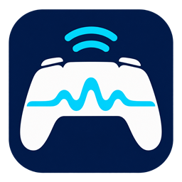

<p align="center">
  
</p>
<h1 align="center">DualSense AirBridge</h1>
<p align="center">让 DualSense 的精细触觉，跨过那根 USB 线。</p>
<p align="center"><strong>简体中文</strong> · <a href="README.en.md">English</a></p>
<p align="center">Windows x64 · 普通 DualSense · 开发预览版 0.1.4 · MIT</p>

DualSense AirBridge 是面向 **Windows PC 与普通 DualSense 手柄**的非官方蓝牙桥接工具。手柄照常通过 Windows 蓝牙配对，工具向游戏提供虚拟 USB DualSense，让兼容游戏使用原生输入、精细触觉和自适应扳机反馈通道。

它面向支持原生 DualSense 的 PC 游戏，**不是所有 PS / Xbox 手柄通用的映射器，也不会为没有相关反馈的游戏自动增加效果**。首个重点验证游戏为《影之刃：零》（Phantom Blade Zero）。

> **预览版边界：** 已有单机实测和用户反馈，尚不是广泛兼容性认证。手柄扬声器当前实测无声，麦克风和 3.5mm 音频未完成验收；不宣称“所有 USB 功能已完整无线化”或“零延迟”。

## 功能与支持范围

| 项目 | 当前状态 |
| --- | --- |
| 普通 DualSense，VID `054C` / PID `0CE6` | 当前唯一允许桥接的型号 |
| 按键、摇杆、扳机输入、触控区 | 已进行输入转发和人工对照 |
| 左右精细触觉 | 独立测试及游戏体感已确认；不是仅用普通马达震动替代 |
| 自适应扳机 | 转发游戏输出；内置 R2 阻力与取消归零测试已通过 |
| 原生 USB / 蓝牙恢复 | 正常停止后清理本次配置，并检查实体输入与原音频端点 |
| 独立蓝牙耳机共存 | Bose 测试环境中已通过多轮观察，不代表所有适配器都无干扰 |
| 手柄扬声器 / 麦克风 / 3.5mm 音频 | 扬声器未通过；其余未验收，暂不列为已支持功能 |
| DualSense Edge / DualShock 4 / Xbox 手柄 | 不支持桥接；其他设备的并发兼容仍需实测 |
| Linux / macOS / Windows ARM64 | 本项目当前未适配 |

内置“反馈测试”和“延迟对比”，可用相同信号比较物理 USB 与蓝牙桥接。软件统计只能描述内部队列和报告到达，**不能替代物理端到端延迟测量**。

## 开发中：电量与扬声器控制

当前源码还包含一轮**仅界面与交互**的改版：浅色分组、侧栏导航、独立的“检查与恢复”及“使用指南”，并统一反馈测试与延迟对比窗口。桥接启停、电量读取、静音、音频保护、反馈与延迟采集逻辑保持不变。此界面尚未发布，详见 [界面改版说明](docs/ui-refresh.md)。

以下功能属于尚未发布的 `0.1.5-dev` 源码，GitHub v0.1.4 附件不含这些改动：

- 主窗口约每 5 秒刷新电量和充电状态。桥接时复用已接收的输入报告，不额外向手柄发送查询；电量只有约 10% 的档位精度，显示为“约”。原生连接只读一个共享输入报告，不切换报告模式；简短的原生蓝牙报告可能不提供电量。断连、超时和未知状态不会显示为 0%。
- **手柄扬声器默认静音**，主窗口可取消勾选，让游戏控制扬声器声音。每次打开程序默认勾选，只作用于本次桥接；保留精细触觉、自适应扳机、麦克风及 3.5mm 耳机字段。不静音整个四声道虚拟 USB 音频设备。
- 显示 Windows 默认播放设备、音量和静音读数，约每秒只读刷新。该读数不是音箱实际响度的证明；Bose 音量键失效仍需原生／桥接对照，当前不宣称修复。

这些功能不添加自启项、系统服务或新驱动。详细实现、协议参考及验收边界见 [电量与音频控制](docs/controller-controls.md)。

## 工作方式

```text
支持原生 DualSense 的 PC 游戏
             ↕ USB 输入 / 输出 / 音频
虚拟 USB DualSense（usbip-win2）
             ↕ 本机 USB/IP
受会话管理的 vDS 修改版后端
             ↕ Windows 蓝牙 HID
普通 DualSense 手柄
```

HidHide 在桥接期间对其他应用隐藏选中的实体手柄，减少同时读取实体和虚拟设备导致的重复输入。工具记录修改前的状态，停止时撤销本次变更。vDS 后端随桥接会话启动和退出，不安装原版 vDS 常驻服务。

## 安装与使用

已验证环境为 **Windows 11 x64**；需要可正常连接手柄的蓝牙适配器。其他 Windows 版本、适配器和固件组合尚未全面验证。

| 组件 | 用途 | 本项目已测试版本 |
| --- | --- | --- |
| [usbip-win2](https://github.com/vadimgrn/usbip-win2/releases/tag/v.0.9.8.1) | 虚拟 USB 控制器及本机设备导入 | 0.9.8.1 x64 |
| [HidHide](https://github.com/nefarius/HidHide/releases/tag/v1.5.230.0) | 隔离目标实体 HID，避免重复输入 | 1.5.230.0 x64 |
| .NET 9 运行时 | Windows 桌面程序 | 自包含构建随包携带，无需另装 SDK |
| vDS 修改版、Opus | 蓝牙协议桥接与音频编码 | 随构建携带；Opus 静态链接 |

usbip-win2 与 HidHide 是**系统级依赖**，应从上游官方发行页安装，并按安装器提示重启。工具不会自动安装驱动或修改固件。依赖驱动可以随 Windows 加载；“工具不开机自启”不等于“系统里没有已加载驱动”。第三方安装器自己的服务、任务或更新器由其设置决定。

1. 从 [Releases](https://github.com/stayupchampion/DualSense-AirBridge/releases) 获取 Windows x64 发布包并完整解压，也可按下文从源码构建。不要只复制单个 EXE。
2. 安装上述依赖。已有共享组件时先核对版本，避免重复安装或覆盖其他手柄软件的配置。
3. 退出游戏，拔掉手柄 USB 数据线，使用 Windows 正常配对并连接 DualSense。先关闭可能接管该手柄的映射软件。
4. 启动包内 `DualSenseBridge.exe`。可执行文件名称沿用早期版本；项目发布名为 **DualSense AirBridge**。程序界面目前为简体中文。
5. 点击“检查连接”，选择蓝牙 DualSense，再点击“启用蓝牙桥接”；会话管理器会申请管理员权限。
6. 等待连接成功，再启动游戏。游戏需要支持原生 DualSense；必要时在该游戏的 Steam 属性中将“控制器 → 覆盖”设为“禁用 Steam 输入”，让游戏直接读取虚拟 DualSense。无需全局关闭所有手柄支持。
7. 结束时先退出游戏，再点击“停止并恢复原生”，或正常关闭工具。恢复完成后可继续使用原生蓝牙或插回 USB。

不要在游戏运行中来回切换模式：虚拟 USB 与实体蓝牙是不同设备，游戏可能需要重启才能重新识别。

## 日常使用、恢复与卸载

- **默认不开机自启。** 不创建自动桥接服务或计划任务；只打开窗口也不会自动启用桥接。
- 仅对选中的普通 DualSense 应用隐藏规则；遇到已有规则冲突、其他映射软件、本机 `3240` 端口占用或未完成恢复记录时，拒绝启用。
- 尝试保护原有默认音频输出，不把游戏主声音路由到手柄，不启用独立耳机的麦克风。蓝牙无线资源仍然共享，不能保证所有环境都没有卡顿。
- 正常退出会停止输出、释放扳机与震动、移除本次虚拟设备并恢复本次隐藏配置。发现外部同时改动时报告冲突，避免直接覆盖别的软件配置。
- 主窗口异常退出时，由独立会话进程尝试恢复。**断电、系统崩溃或同时强杀所有进程时，可能遗留隐藏规则**；再次打开工具，先执行“恢复遗留状态”。恢复完成前不要删除程序的 `.local/` 目录。
- 删除程序目录不会卸载系统驱动。需要卸载时，在恢复完成后通过 Windows“已安装的应用”分别处理；其他软件也使用这些依赖时应保留共享组件。

## 延迟优化与验证

0.1.3 修复了 USB/IP 接收线程中 HID 输入等待阻塞音频的问题，调整本机 TCP 发送，并将预缓冲设为 **3 块，约 32ms PCM 音频量**。0.1.4 保持该配置，把普通诊断日志交给有界后台队列，并将统计文字拼接移出共享状态锁，减少诊断工作引起的偶发等待。

当前验证包括 **121 项 C# 检查**、C++ 运行时与诊断并发检查、补丁兼容性检查、手柄触觉/扳机/取消测试，以及停止后约 **90 秒、19 次恢复观察**。用户反馈震动体感已接近 USB，本轮 Bose 播放正常。这些结果属于特定机器与测试窗口，不代表任意游戏或无线环境下的等延迟、永久稳定保证。

详见 [0.1.3 震动优化](docs/haptics-latency-optimization.md)、[0.1.4 诊断优化](docs/diagnostic-jitter-optimization.md)、[软件验证](docs/validation.md)、[反馈测试](docs/feedback-tests.md) 和 [延迟对比方法](docs/latency-comparison.md)。历史记录中的状态以日期和对应版本为准；文中 `.local/` 原始回执不包含在源码仓库中。

## 从源码构建

开发依赖：.NET 9 SDK、Visual Studio 2022 C++ 工具链及 Windows SDK、Python 3、CMake。普通使用者不需要这些开发工具。

```powershell
# 在仓库根目录执行
powershell -NoProfile -ExecutionPolicy Bypass -File scripts/build.ps1
powershell -NoProfile -ExecutionPolicy Bypass -File scripts/test-backend.ps1
```

输出为 `dist/DualSenseBridge/`。构建会下载并校验固定版本的 vDS 与 Opus 源码，缓存放在项目 `.local/`，不会安装系统驱动。默认使用 VS 2022 Community 自带 CMake 路径；其他安装位置可先给 `scripts/build-backend.ps1` 传入 `-CMake` 和 `-Python`，再运行 `scripts/build.ps1 -SkipBackend`。

`scripts/check-installed-drivers.ps1` 只读系统状态，报告写入 `.local/logs/`。`scripts/install-drivers.ps1` 供维护者使用，要求预先下载指定安装包、管理员权限和显式 `-InstallApproved`；初次安装推荐上述官方安装器流程。`scripts/test-hardware-session.ps1` 会实际启停桥接，需管理员权限、游戏关闭且仅一只普通蓝牙 DualSense，使用前先阅读脚本。

标签发布由 GitHub Actions 从源码重新构建、运行软件检查并生成 ZIP、SHA-256 及构建清单。CI 不安装驱动、不连接实体手柄；实机验收结论来自上述开发环境。

## 致谢、参考项目与依赖

**桥接协议与后端以 [hurryman2212/vds](https://github.com/hurryman2212/vds) 为代码基础，并非从零逆向实现。** 固定提交为 `ec531599dfdd02e14ce68efd8c0d2dcb439894a5`。本项目在此基础上增加 Windows 会话与恢复管理、测试界面、输入/音频调度修复和诊断优化。可审阅 [补丁说明](patches/README.md)、[完整补丁](patches/vds-managed-session.patch) 和 [源码摘要](patches/vds-managed-session.json)。

| 项目 | 关系与贡献 | 许可 / 分发方式 |
| --- | --- | --- |
| [vDS](https://github.com/hurryman2212/vds) | 核心 USB ↔ 蓝牙桥接代码基础 | MIT；保留[原许可](licenses/vDS-MIT.txt) |
| [usbip-win2](https://github.com/vadimgrn/usbip-win2) | Windows 虚拟 USB 驱动与客户端 | 上游 BSD-2-Clause；独立安装，以上游包内通知为准 |
| [HidHide](https://github.com/nefarius/HidHide) | 目标手柄的 HID 隐藏与白名单 | 上游 MIT；独立安装，保留其安装包许可 |
| [Opus](https://opus-codec.org/) | 音频编码库，固定 v1.5.2 | BSD 风格许可；静态链接，[许可](licenses/Opus-BSD.txt)及[补充说明](licenses/Opus-LICENSE_PLEASE_READ.txt) |
| [.NET / Windows Forms](https://github.com/dotnet/winforms) | C# 桌面界面与运行时 | 上游开源代码与随包运行时分别按其许可；保留[运行时分发条款](licenses/dotnet-LICENSE.txt)与[第三方通知](licenses/dotnet-THIRD-PARTY-NOTICES.txt) |
| [DS5Dongle](https://github.com/awalol/DS5Dongle) | 蓝牙音频与缓冲机制的协议调研参考 | 非运行依赖；本项目补丁未直接复制其源码，不需要 Pico 硬件 |
| [DualSense Explorer](https://github.com/nondebug/dualsense) | HID 报告、扳机字段与测试思路参考 | 非运行依赖 |
| [Rea](https://github.com/morluto/rea) | 项目最初的逆向研究工具线索 | 非代码基础、构建或运行依赖；当前方案未使用 Rea 逆向游戏或固件 |

感谢这些项目及其贡献者公开的实现和资料。上游支持范围不自动等于本项目已验证范围，例如本版仍只允许普通 DualSense。

## 反馈问题

请提供工具版本、Windows 版本、蓝牙适配器、手柄型号/固件、游戏与启动平台、Steam 输入设置，以及“USB 原生 / 蓝牙原生 / 蓝牙桥接”中哪些模式会复现。可附脱敏日志；分享前移除设备地址、用户目录等本机信息。

## 许可证

本项目自有代码采用 **[MIT License](LICENSE)**。第三方代码保留各自的版权及许可，见 [licenses/](licenses/)。项目图标与使用说明见 [assets/branding/](assets/branding/)。

DualSense AirBridge 是非官方社区项目，与 Sony / PlayStation、S-GAME、Microsoft 无隶属、认可或官方支持关系。DualSense、PlayStation 等名称归各自权利人所有。
