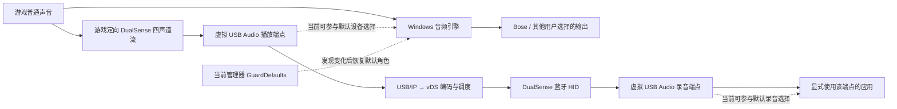

# 桥接与系统音频隔离：静态审查与下一版设计

日期：2026-11-02，Asia/Shanghai。审查基线：[`b77979c`](https://github.com/stayupchampion/DualSense-AirBridge/commit/b77979c171b61f34084ffcec3797215016fdabda)，`0.1.5-dev`。

本轮只阅读源码、历史记录和 Microsoft 文档，离线解析已有数据。没有连接设备、启用桥接、调用实时设备诊断，也没有修改驱动、注册表、蓝牙、系统音频或桥接功能。本文件是下一版研究结论，不是修复完成声明。

后续实现另见 [0.1.5-dev.2 音频保护候选版](audio-safety-candidate.md)。下文保留上述基线的审查结论，不代表后续候选版仍使用相同实现。

## 结论与优先级

**当前实现尚未达到音频路由隔离。最需要改变的是虚拟音频端点的默认设备资格，而不是进一步加快“抢占后切回”的轮询。**

1. 虚拟 DualSense 暴露标准 USB 播放和录音接口。当前没有为它们设置“不可成为默认端点”的策略；管理器在端点已经成为默认设备后，调用 `SetDefaultEndpoint` 恢复启动时的设备。这存在可从源码确定的时间窗口。
2. Bose 曾经“已连接但无声”的现场，确有播放端点 `UNPLUGGED`、没有默认播放设备。采样晚于桥接工作线程断开约 5 秒，无法判定蓝牙音频与手柄谁先失效，不能认定只是默认设备选错。
3. 后来的音量故障在桥接关闭时仍复现。已有记录中，Bose 一直是三个播放角色的默认端点，Windows 音量在约 12%～66% 变化，用户报告响度不变。需要独立追踪蓝牙音量控制链；不能把切回默认输出当作此问题的修复。
4. 另发现虚拟 USB 音频的确定性缺口：扬声器 Feature Unit 和麦克风 Feature Unit 共用音量／静音状态。它影响虚拟手柄内部语义，但没有直接控制 Bose 的代码路径。
5. 推荐下一版先验证“仅虚拟设备适用的枚举前音频策略”，保留游戏需要的四声道端点，同时禁止它参与默认播放和默认录音选择。该方案涉及设备标识、INF 策略及签名／部署可行性，尚不能承诺只改用户态代码即可实现严格隔离。

逻辑隔离的目标是：工具不打开 Bose 播放／录音流，不设置其音量、静音、默认角色、格式或蓝牙属性；虚拟端点从首次出现起就不抢默认角色。手柄和耳机仍可能共享同一个蓝牙适配器及无线资源，这一物理条件不能由音频路由隔离消除。

## 1. 实际数据路径与控制路径

这里的“通道”有两层：Windows 默认端点／应用流路由，以及手柄 PCM 的四个声道。不是把 Bose 的物理蓝牙音频通道直接复用成手柄通道。

离线解析当前生成源码的 USB 描述符得到：227 字节配置、4 个接口；接口 0 为 AudioControl，接口 1 为 48 kHz／16 bit／4 声道播放，接口 2 为 48 kHz／16 bit／2 声道录音，接口 3 为 HID。播放 Feature Unit 为 2，录音 Feature Unit 为 5。设备 VID/PID 为 `054C:0CE6`，`bcdDevice=0x0100`，没有 USB 序列号字符串。

四声道中的前两声道供扬声器／耳机音频使用，后两声道供精细触觉使用。当前 `vds_usbip.cc:1652–1682` 只对前两声道应用 USB 音量增益。系统整体禁用此播放端点会让游戏无法投递原有触觉流；系统软件静音／增益也不能假定只作用于扬声器声道。

当前反馈测试在 [AudioFeedback.cs](../src/DsBridge.App/AudioFeedback.cs#L30) 按目标 USB 根节点寻找端点，直接打开该端点的共享模式流，不依赖默认输出。用户界面的 [AudioVolume.cs](../src/DsBridge.App/AudioVolume.cs#L37) 仅查询音量。后端源码中的 `waveout` 是手柄测试音合成，并非抓取 Bose 或系统声音的回环录音。

## 2. 历史证据重新核对

下表来自本地原始文件，时区均为 +08:00。原始设备实例 ID、MAC、完整端点 ID 和进程 ID 不放入公开文档。

| 证据 | 本轮确认的事实 | 不能据此推出的结论 |
| --- | --- | --- |
| 2026-10-31 长会话，简称 E1 | 桥接 13:50:03 启动；17:22:20.134 收发线程报错，17:22:20.211 USB/IP 客户端断开；17:22:25.389 的管理器清理前采样已显示 Bose 播放状态 8，三个播放默认角色均缺失；17:22:31.208 仍如此 | Bose 是被管理器停止动作断开的；或者 Bose 一定在手柄之前断开。首次音频采样已经晚了约 5.25 秒 |
| 随后用户反馈 | 故障在桥接停止后持续，Bose 局部重连未恢复，重启 PC 后恢复 | 必然是 Bose 固件、必然是 Windows 驱动，或桥接绝对无关 |
| 2026-10-31 23:52 手动关机对照，E2 | 清理前后 Bose 播放／录音端点均为 ACTIVE，播放默认角色保留 | 自然待机已经通过。它是另一轮短时手动对照 |
| 2026-11-01 00:08～01:23 候选会话，E3 | 01:23:05 的记录显示播放 communications 角色和三个录音角色转到 DualSense；Bose 仍 ACTIVE；管理器因端点归属无法确认停止 | 该新增端点一定属于本次虚拟设备。历史归属验证失败，不能排除其他来源 |
| 2026-11-01 14:14～16:22，E4 | 保存了 256 条时间线；最后一次音频采样超时 | 最后一条中的不可用标记等于设备实际断开。该条有明确错误，属于未知状态 |
| 2026-11-01 22:45～11-02 00:05，E5 | 163 条时间线中未出现 DualSense 默认角色，也没有启动端点不可用记录 | 期间所有声音和音量均正常；端点存活不是实际响度或连续播放证明 |
| 2026-11-02 00:22:08～00:24:08 原生音量观察，E6 | 447 个历史样本，Bose 端点 ID 不变、始终承担三个播放默认角色；24 个不同音量值，范围约 12%～66%；静音一直 false；硬件能力值 3；观察与端点音量读取无错误 | Windows 数值改变就代表扬声器物理响度改变 |
| 同轮端点／会话快照，E7 | `vdsd` 进程数为 0；已读到的 DualSense 音频端点状态均为 4；网易云音乐的活动播放会话在 Bose 上；已读到的 Bose 录音会话只有非活动系统会话 | 当时整个系统没有其他录音／通信行为。快照另有 6 个端点读取失败，且没有记录流的 category 或 shared/exclusive 模式 |

状态数值对应 Microsoft 的 [DEVICE_STATE_XXX](https://learn.microsoft.com/en-us/windows/win32/coreaudio/device-state-xxx-constants)：1 是 ACTIVE，4 是 NOTPRESENT，8 是 UNPLUGGED。蓝牙设置中的“已连接”与可播放音频端点处于 ACTIVE 不是同一个判断。

**更正历史文档的证据归属：** 原 `reconnect-investigation.md` 把会话 `e12e…` 列作故障证据；它实际是 E2 的手动关机对照。长会话故障证据是 `89a2…`。本轮已修正该文档的指向，并明确“管理器清理前”不等于“后端断开前”。

E6/E7 是“关闭桥接后的基线”，不是“这台电脑从未运行过桥接”的干净基线。它们说明故障无需桥接当前运行就能持续，不能排除先前状态变化留下的影响。

## 3. 源码中确定的问题

### F1：端点具备默认设备资格，保护属于事后恢复

[Audio.GuardDefaults](../src/DsBridge.App/Audio.cs#L151) 先获取当前默认设备，识别新出现的 DualSense 端点、核对 USB/IP 祖先，再对启动时设备调用 `PolicyConfig.SetDefaultEndpoint`。源码没有在虚拟音频端点发布前设置 NeverSetAsDefault 策略。

[SessionWorker.cs](../src/DsBridge.App/SessionWorker.cs#L114) 启动循环末尾等待 150 ms，活动循环末尾等待 500 ms。实际检查间隔还包含 Core Audio 枚举、HidHide 查询、IPC 和调度耗时，**150／500 ms 不是恢复延迟上界**。启动时“连接连续 3 秒、最近 1.5 秒没有纠正”只能降低启动游戏时的风险，不能保证后续热插拔或重连没有短暂切换。

Windows 会在端点出现或活跃状态变化时重新评估默认设备。新端点可能得到优先考虑，因此把它恢复回去不等于从未切换。[Microsoft 默认端点选择机制](https://learn.microsoft.com/en-us/windows-hardware/drivers/audio/default-audio-endpoint-selection)

应用是否跟随默认设备迁移，取决于其使用的音频 API 和流路由实现。Windows 10 1607 起 WASAPI 可以选择自动路由激活方式，但不是任意已绑定端点的流都会自动迁回。因此管理器恢复默认设备后，不能保证所有游戏／播放器都已经恢复声音。[Microsoft 自动流路由](https://learn.microsoft.com/en-us/windows/win32/coreaudio/automatic-stream-routing)

### F2：恢复依据固定启动快照，且涉及录音角色

[RecoveryAssessment.ShouldRestoreDefault](../src/DsBridge.Core/RecoveryAssessment.cs#L10) 有几个明确边界：

- 原端点已不可用、当前没有默认端点时，不执行恢复。这能避免把断开的耳机强行设回，却不能修复 E1 的无默认播放设备状态。
- 只考虑不在启动时 ACTIVE 列表中的端点；已有端点重新成为默认、非预期命名等情况不属于这条规则。
- 先按友好名称筛选，再验证设备祖先。名称不是权威身份；归属验证失败会停止桥接。E3 确实走到了此分支，但归属失败原因仍未知。
- 启动快照不会跟随用户的后续选择。例如启动时为 A，用户改到 B，随后虚拟端点 D 成为默认；只要 A 仍活跃，当前实现会恢复 A。它无法从现有状态判断“应当保留用户后来选的 B”。
- 快照包括播放、录音各三个角色。恢复默认录音可能导致正在跟随默认麦克风的应用换设备。这是间接影响语音路由的入口，并不意味着管理器自己打开了 Bose 麦克风。

Windows 11 的经典蓝牙音频可因应用打开该设备的录音端点，或创建 `Communications` 类别播放流而切到 HFP。**没有活动录音快照，也不足以排除通信播放触发 HFP。** 当前日志未记录流类别和实际 profile，不能把这个可能链条当成已证明的根因。[Microsoft Bluetooth Classic Audio](https://learn.microsoft.com/en-us/windows-hardware/drivers/bluetooth/bluetooth-classic-audio)

### F3：虚拟扬声器与麦克风 Feature Unit 状态混用

生成源码 `src/platform/win32/vds_usbip.cc:1580–1630` 中，Audio Class 控制分支只区分 `wValue` 高字节的 mute／volume selector，没有按 `wIndex` 高字节的实体 ID、低字节接口、以及 `wValue` 低字节声道分别分派。设备描述符却声明了两个独立 Feature Unit：2 和 5。

因此可以静态推导：针对麦克风 FU 5 的合法 `SET_CUR MUTE` 与针对扬声器 FU 2 的同类请求，会写同一个 `fu_muted`；前者随后也会改变 `speaker_gain_q15`。麦克风音量和扬声器音量的读回同样共用 `fu_volume_db256`。麦克风返回路径 `take_mic_bytes` 未使用这组扬声器增益。

后续修复应以 `(接口, 实体, selector, 声道, 方向, 长度)` 严格分派，分开播放与录音状态，按描述符支持的主声道控制处理请求，拒绝未知／不支持组合。同时保留后两路触觉原始样本。另有 `GET_MIN` 注释写 -100 dB，但返回字节 `01 DA` 按有符号 1/256 dB 解码约为 -38 dB，应一并核对声明范围。

这属于虚拟手柄音频实现错误。Bose 的 USB／蓝牙音量请求不会经过这个 `VirtualPort`，所以不能把它宣称为 Bose 音量故障的直接原因。本轮没有修改该代码。

### F4：观测不足以支持“完全恢复”的结论

- `GuardDefaults` 在修正完成后才把**修正前**快照送给时间线回调；若归属验证或设置默认设备抛异常，该快照不会进入回调。缺少独立的“观察、拟执行、执行结果、再读验证”记录。
- `AudioTimeline` 最多 256 条；仅按 30 秒心跳估计约覆盖最近 128 分钟，状态频繁变化时更短。E4 已达到容量。较长静置会话的起始信息可能被挤出。
- 音频枚举超时与真实 `UNPLUGGED` 必须分开。空结果加 Error 不能算设备掉线。
- 会话退出的约 5 秒观察不能覆盖几十秒后出现的故障；也不能证明声音或音量键正常。
- `ConfigurationRestored=true` 证明本工具配置清理完成，不代表蓝牙音频健康、游戏重新识别控制器或用户听感正常。当前代码已把清理与健康警告分开，下一版应保留这一界限。

### F5：旧版重连竞争已收敛，但不是音频修复证明

旧后端允许工作线程结束后约每秒尝试重新连接，管理器则在另一条生命周期上结束断连会话。新的候选后端在 `vdsd.cc:2768–2791` 检测到工作线程结束后退出监督循环，不再后台自动创建下一轮桥接。

这减少了手柄重连时反复出现虚拟 USB／音频端点的机会，也避免 UI 认为原生而后端重新接管。但仍待自然待机实测；当前没有条件补做，不能把软件状态修正等同于 Bose 故障修复。

### F6：系统音频查询仍与桥接停止协调共用执行路径

`SessionWorker` 的活动循环直接同步调用 `Audio.GuardDefaults`，该方法中的 COM 枚举／拓扑查询没有应用级超时。主窗口的停止操作先写 `stop.request`，由这个循环发现请求后再设置后端停止事件。如果系统音频调用长时间不返回，停止请求就可能被拖延；主窗口等待 45 秒也不能中断已经挂起的 COM 调用。

这是源码层面的故障传播风险，不是已证明发生过的卡死。`RecoveryDiagnostics` 对一次观察的等待设了上限，但 `WaitAsync` 超时也不会取消底层 `Audio.Observe()`；若连续超时后继续创建新任务，可能累积未结束的查询。下一版应使停止协调独立于音频观察，并限制观察并发数；音频服务失去响应时显示未知、停止新增观察，不能让其阻挡本会话的后端停止和设备清理。

## 4. Bose 音量失效应怎样归因

| 候选原因 | 当前证据评价 | 还缺什么 |
| --- | --- | --- |
| 音量键正在调虚拟手柄 | E6 这轮不支持：Bose 始终为三个播放默认角色，记录到的是 Bose 音量 | 若未来桥接中复发，需要同一时刻核对实际被控制端点和活动流 |
| 播放器仍在错误设备上 | E7 这轮不支持简单版本：网易云活动播放会话在 Bose 上 | 流创建时间、类别、模式以及听感同步证据 |
| 独占模式绕过软件音量 | 目前无独占模式证据，不能定因；Bose 还报告了硬件音量能力 | 实际流模式、驱动能力是否正确以及硬件命令执行情况 |
| AVRCP 绝对音量控制／同步失效 | 与“系统数值变化、设备响度不变”相容，值得优先验证；不是已确认 | 发生时的 SetAbsoluteVolume、返回／通知、设备实体音量变化以及新系统基线 |
| HFP/A2DP 切换或持久音频驱动状态异常 | 旧现场出现过独立 Hands-Free 播放会话；重启曾恢复声音，支持保留此方向 | 故障首发前的 profile、通信流与驱动事件关联 |
| 无线资源竞争 | 手柄与 Bose 共用适配器时机制上可能存在 | 实际丢包／调度、不同负载与长时对照；仅凭掉线或 USB/IP 队列不能定因 |

硬件能力值 3 表示驱动报告支持硬件音量与静音；这是能力声明，不是物理执行回执。[Microsoft 能力标志](https://learn.microsoft.com/en-us/windows/win32/coreaudio/endpoint-hardware-support-xxx-constants)

有硬件音量时，Microsoft 定义的端点音量应同时影响 shared 和 exclusive 流。因此“独占播放必然不受 Windows 音量影响”不适用于所有设备，不能直接套在本次 Bose 上。[IAudioEndpointVolume](https://learn.microsoft.com/en-us/windows/win32/api/endpointvolume/nn-endpointvolume-iaudioendpointvolume)

Microsoft 的蓝牙配件规范说明，Windows 调整音量 UI 时可发送 AVRCP `SetAbsoluteVolume`，配件应据此改变实际音量。E6 只观察到了此链条的 Windows 数值端，没有观察协议和执行端。[Bluetooth 配件音量规范](https://learn.microsoft.com/en-us/windows-hardware/design/accessory-guidelines/bluetooth-accessory-guidelines/bluetooth-accessory-guidelines-classic-audio)

下一版不应把全局 `DisableAbsoluteVolume`、禁用 Bose Hands-Free、重启蓝牙服务或重置适配器作为桥接的自动行为。这些会改变其他设备的使用条件，也不能替代定位原因。

## 5. 下一版推荐架构

### 5.1 不变量：桥接拥有的范围限定为自身虚拟设备

建议把以下条件做成设计约束和后续验收条件：

1. 不设置任何外部音频端点的默认角色、音量、静音、格式和应用路由；不创建外部设备的音频流或打开其麦克风。
2. 虚拟播放端点保留四声道和游戏可寻址性，但不具备默认设备资格；虚拟录音端点也不具备默认资格。播放与录音都要覆盖各默认角色。
3. 手柄扬声器默认静音继续在手柄输出协议中执行，不将整个四声道端点静音；麦克风能力与扬声器开关分离。
4. 首次枚举、重新枚举、升级和退出均适用同一策略，不依赖游戏启动前“等几秒让它恢复”。
5. 用户主动换耳机、改音量或关闭 Bose 时，工具观察并更新显示，不把其恢复成启动时的设置。
6. 端点归属必须由确切设备实例、虚拟总线祖先及会话关系确认，不能仅凭名字或 Sony VID/PID。USB 原生手柄不得落入该策略。
7. 隔离策略缺失或无法确认时不能宣称“已隔离”。对要求严格隔离的模式，应在准备阶段阻止启用；若出现运行期违例，仅停止和移除本会话资源，保留可解释的状态，不全局修复系统。

这些是拟议约束，当前版本还没有全部满足。

### 5.2 首选研究路线：端点枚举前配置 NeverSetAsDefault

Microsoft 提供 `PKEY_AudioDevice_NeverSetAsDefaultEndpoint`，通过音频设备接口 INF 的 `EP\n` 属性配置，并要求在同一子键配置 `PKEY_AudioEndpoint_Association`。它限制默认设备资格，而非把整个端点禁用。对应角色下，用户也不能在系统声音界面把该端点设为默认设备；这是采用此策略的功能取舍。[官方属性说明](https://learn.microsoft.com/en-us/windows-hardware/drivers/audio/pkey-audiodevice-neversetasdefaultendpoint)

需要单独验证的工程关卡：

- **只匹配虚拟实例。** 不能直接向所有 `USB\VID_054C&PID_0CE6&MI_00` 安装同一策略，否则可能影响实体 USB 手柄。当前虚拟设备复用了真实 VID/PID，仅换显示名称或序列号不足以让普通 INF 的 Models 匹配区分两者。
- **细化标识的候选。** 可以研究虚拟设备独立且稳定的 `bcdDevice`，用含 `REV_…&MI_00` 的音频集合硬件 ID 做窄匹配，同时保留 HID 的 VID/PID 与报告格式。Windows 文档支持这种硬件 ID 形式。但 revision 不是获分配的独立产品身份，必须检查真实硬件碰撞，验证游戏 SDK 对版本的兼容，并设计升级迁移；未经验证不能称为安全方案。[USB 接口集合标识](https://learn.microsoft.com/en-us/windows-hardware/drivers/usbcon/support-for-interface-collections)
- **合适的部署层。** 研究签名的音频扩展 INF，或其他能在当前 UAC1 类驱动枚举前生效的受支持设备配置方式。扩展 INF 可定制基础包，按硬件／兼容 ID 匹配；不能把“官方支持此属性”直接推导为“当前 USB/IP 设备立即可用”。需要核实接口注册位置、Association、安装顺序、签名和卸载语义。[Extension INF](https://learn.microsoft.com/en-us/windows-hardware/drivers/install/using-an-extension-inf-file)
- **首次到达即有效。** 首次出现端点后再写属性、再禁用／启用，只能算事后修补；仍有首次抢占窗口。应先准备并确认正确策略，再创建虚拟设备，创建后只做验证。验证步骤本身不消除先前的竞争窗口。
- **保持专用流可用。** 从机制上这不是 DisableEndpoint，但仍须验证游戏能枚举／显式打开四声道端点并送出精细触觉，触觉不被普通主音量或默认静音消掉。
- **区分默认资格与显式路由。** 游戏的专用触觉流应继续显式指向虚拟手柄；播放器或用户以前保存的逐应用端点绑定则是另一件事。NeverSetAsDefault 不应被解释为禁止所有应用显式使用该设备，也不能替代核对已有的应用路由。工具不应为此批量清空用户设置。
- **角色掩码待核实。** 当前官方页面示例为 `0x307`，后文与表格又提到 `0x305`，存在不一致。实现前要按目标 Windows/SDK 核对并实测 playback/capture 的 console、multimedia、communications，不能直接复制一个数值就宣布覆盖全部角色。

官方也提示 Core Audio 端点属性由系统维护，应用可以读但不应随意设置。因此不推荐把直接修改 `MMDevices` 全局注册表作为正式替代方案。[音频端点属性](https://learn.microsoft.com/en-us/windows/win32/coreaudio/audio-endpoint-properties)

本路线可能增加一个经过签名验证的配置包及安装维护成本，并改变用户把虚拟手柄设为默认声音设备的能力。若下一轮确需安装新包，应先完成可审查的包与作用范围说明，再取得安装确认；本轮没有安装或生成可安装驱动。

### 5.3 在严格隔离尚未实现前，哪些改进有用

| 方案 | 价值 | 不能保证的部分 |
| --- | --- | --- |
| Core Audio 事件通知替代密集轮询 | 更快记录新增／移除／默认变化，降低重复枚举；便于分析先后关系 | 通知发生在变化之后，不能阻止首次抢占 |
| 缓存已确认的本会话端点身份，记录最新非虚拟默认选择 | 减少临时拓扑查询失败与固定启动快照误恢复 | 仍需处理用户改动与自身操作的竞争，不能变成无限“抢回默认设备”循环 |
| 对默认变更记录操作前后回读与错误 | 明确到底改了哪个角色、是否成功，而不是只写“已阻止” | 不提供实际响度和完整系统状态证明 |
| 单次连接会话、断连后手动启用 | 避免自动重建虚拟音频端点扩大竞争 | 不治疗 Bose 已经存在的 profile／音量故障 |
| 修复 Feature Unit 分派 | 保证虚拟扬声器／麦克风各自的音量语义 | 不能修复 Bose AVRCP 链条 |

事件回调只入队时间戳和状态，不做磁盘写入、COM 长调用或等待。Microsoft 要求 `IMMNotificationClient` 回调不阻塞；处理与日志留在独立控制路径，继续保持已验证的触觉缓冲与收发调度。[IMMNotificationClient](https://learn.microsoft.com/en-us/windows/win32/api/mmdeviceapi/nn-mmdeviceapi-immnotificationclient)

不建议这一轮先删除全部 USB 音频接口、改成只有 HID、改为全局音频代理，或重写成另一套虚拟音频驱动。前者丢失当前精细触觉通路，后者会扩大兼容与维护范围。默认设备隔离不要求把所有声音接管到工具里。

## 6. 后续实现顺序与验收门槛

本轮没有执行下列实现或实机测试。推荐按顺序推进：

### 阶段 A：先验证隔离策略可部署性

明确虚拟音频身份、受支持的属性落点、策略安装先后和签名路线；验证实体 USB 不匹配。不满足这些条件时，交付结论应是“仍只能降低竞争窗口”，不能改名为完全隔离。

保留现有四声道、扳机、输入通路及已验证的 3 块预缓冲／35 ms 启动超时／12 块突发上限／100 ms 过期策略。隔离研究不应重新扩大触觉延迟。

### 阶段 B：实现限定范围的控制与观测

按 F3 修复虚拟 USB 控制分派；保留手柄扬声器默认静音。严格隔离路径去掉常态恢复外部默认设备的职责。为自身端点加入事件观测与有限日志，记录单调时钟、flow/role、状态、归属、操作结果；错误记录为未知，不与断连合并。

按 F6 将音频观察和会话停止协调分开，限制未完成观察数量；把音频枚举超时、事件风暴、服务无响应列入软件故障注入用例，证明它们不会阻挡本次资源的退出清理。

若保留兼容模式的事后恢复，必须明确标成有竞争窗口的旧策略，不能在严格隔离失败时悄悄降级启用。也不应因一次虚拟端点错误就反复操作系统默认设备。

### 阶段 C：设备具备后安排对照

| 场景 | 必须观察的结果 |
| --- | --- |
| 干净重启后、启动工具前的原生基线 | 同一播放器、同一 Bose 端点，Windows 音量键、播放器音量、Bose 实体音量分别记录；先确认基线本身正常 |
| 新策略首次创建虚拟端点 | 所有默认角色的事件记录中，虚拟端点一次也未成为默认；Bose 普通播放连续；游戏仍可定向打开触觉端点 |
| 已缓存设备反复启停 | 启动／停止各轮默认角色不被工具改写，Bose 无需重连，手柄恢复原生，USB 直连功能保持 |
| 游戏运行、自然静置至手柄关机 | 保留游戏与音频，记录手柄最后输入、自然掉线、USB 移除、端点／profile 事件；覆盖超过旧故障长会话的时长 |
| 重连与退出 | 候选版不自动重建桥接；重新启用前身份明确；正常退出、异常后端退出、主窗口退出分别核对 |
| 用户主动更换输出／耳机断开重连 | 工具不把新选择强改回旧 Bose，不恢复用户已经关闭的设备 |
| 语音与通信播放 | 分别测试 Bose 麦克风和 Communications 播放造成的正常 HFP 行为；不要把正常模式切换与异常无声混为一谈 |
| 音量故障复现 | 同步记录端点音量、实际播放会话／类别／模式、物理响度；条件允许时再做受控协议或 ETW 观察，确认绝对音量请求／执行链 |
| 反馈回归 | 精细触觉、自适应扳机、按键／摇杆／触控正常，默认扬声器无声；触觉延迟对照不倒退 |

短时手动关机不能替代自然待机。退出后的观察窗口也应覆盖先前可能延后数十秒才出现的异常。实际响度要靠听感或可复现测量，端点 ACTIVE、API 成功、音量数值变化和音频峰值都不能单独替代。

## 7. 本轮交付与复核方式

- 当前开发版已提交并推送；[GitHub 构建](https://github.com/stayupchampion/DualSense-AirBridge/actions/runs/41400856384) 成功。没有创建新 tag 或 Release，v0.1.4 附件未变。
- 本轮重建的应用与 155 项检查通过，`0.1.5-dev` 包已通过打包脚本检查。打包脚本仅增加预发布版本号兼容，未借此修改音频行为。
- 静态审查使用的 13 个生成源码文件与已提交的补丁清单 SHA-256 全部一致。未把不同版本的源码与日志当成同一版本：E1/E2 属于原正式版运行记录，E3～E5 属于候选版记录。
- 本报告和历史证据归属更正留在本地，供下一版开发使用；未混入已推送的当前版提交。

仅本机存在的证据索引（Git 忽略，公开仓库不包含原始日志）：

| 编号 | 项目内路径 |
| --- | --- |
| E1 | `dist/DualSenseBridge/.local/sessions/89a233d8ace14439a01f6643bb516b20/` 的 `backend.log` 与 `recovery-check-20261031T092225344-01acb346.json` |
| E2 | `dist/DualSenseBridge/.local/sessions/e12e5dfdcc8044dea0b167a1737121fa/` 的恢复记录 |
| E3 | `dist/DualSenseBridge-reconnect-test/.local/sessions/18fbd8a44c784e6d8dac9b82a5e63b71/audio-timeline.json` |
| E4 | 同目录层级会话 `19dc7f0f1b5449d6ad82fbe34072607c` 的 `audio-timeline.json` |
| E5 | 同目录层级会话 `6a07ab8c1d7e4cc7a8b16daf3d645b85` 的 `audio-timeline.json` |
| E6 | `dist/DualSenseBridge-controls-test/.local/volume-native.jsonl` |
| E7 | `.local/controls-native-volume-fault.json`；检查器源码 `.local/reconnect/audio-inspect/Program.cs` |
| 旧 Hands-Free 会话 | `.local/reconnect/audio-sessions.txt` |
| 离线汇总与来源哈希 | `.local/audio-static-review/evidence-summary.json` |
| 汇总脚本 | `.local/audio-static-review/audit_evidence.py`，仅解析文件，不调用设备 API |

后端审查依据为 [固定上游提交](https://github.com/hurryman2212/vds/tree/ec531599dfdd02e14ce68efd8c0d2dcb439894a5) 加 [本项目补丁清单](../patches/vds-managed-session.json)、[生成补丁](../patches/vds-managed-session.patch) 和 [静音过滤器](../patches/controller_preferences.hh)。本文的后端行号对应 `.local/buildsrc/vds/` 下经哈希核对的生成源码；不应直接套用到上游原始文件行号。
